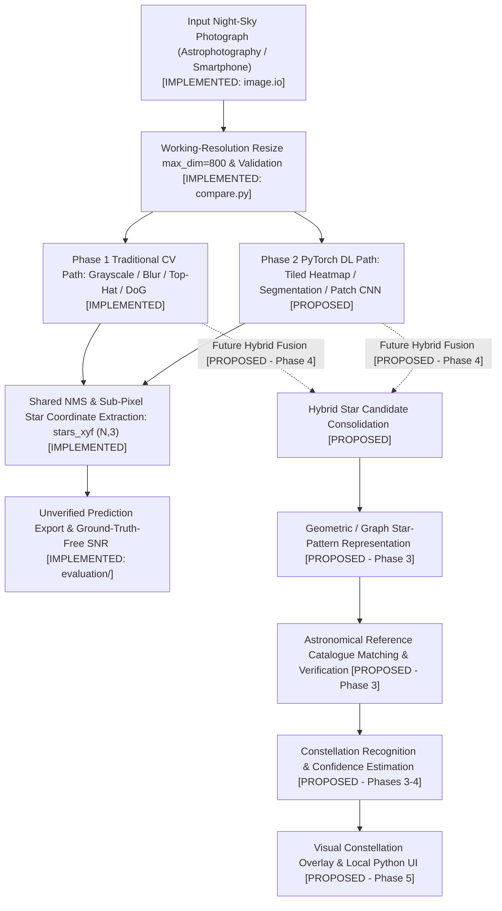

# System Architecture — Vision-Based Constellation Detection and Recognition

> **Last Updated:** 2026-11-21  
> **Repository Baseline:** `constellation-detection v0.1.0` (`main` @ `71bc41b`)  
> **Project Title:** Vision-Based Constellation Detection and Recognition Using Hybrid Computer Vision and Deep Learning

---

## 1. Document Purpose & Source Authority

This document is the permanent, repository-resident technical architecture reference for the project. It eliminates reliance on prior AI conversation transcripts by consolidating verified code facts, planning specifications, and documented discrepancies into a single authoritative reference.

### Source Priority Hierarchy
When interpreting or extending the architecture, sources are weighed strictly in the following order:
1. **Actual existing implementation:** [src/constellation_detection/](../../src/constellation_detection/__init__.py), [tests/](../../tests/__init__.py), [scripts/](../../scripts/download_phase1_samples.py), [pyproject.toml](../../pyproject.toml), [requirements-colab.txt](../../requirements-colab.txt), [notebooks/phase1_traditional_cv_demo.ipynb](../../notebooks/phase1_traditional_cv_demo.ipynb).
2. **Latest approved project brief:** `project-brief_v2.md` *(currently stored externally in `d:\potential captone\project-brief_v2.md`; not yet tracked in Git)*.
3. **Earlier project brief (historical reference only):** `project-brief.md` *(stored externally in `d:\potential captone\project-brief.md`)*.
4. **Existing repository policy, README, and legacy notebooks:** [README.md](../../README.md), [AGENTS.md](../../AGENTS.md), and external Colab/reference notebooks (`01_Project_Initialization_and_CV_Detectors.ipynb`, `constellation-extraction.ipynb`, `combined-deep-learning-notebook.ipynb`).
5. **Task 01 Complete Project Intelligence Audit** (verified on `2026-11-21`).
6. **Explicitly approved new decisions:** None approved post-audit; all open design questions remain marked as unresolved in [DECISIONS.md](./DECISIONS.md).

### Status Tag Legend
- **`[IMPLEMENTED]`** — Verified present in active tracked code and executed locally.
- **`[HISTORICAL REFERENCE]`** — Preserved in pre-migration notebooks outside the repository for provenance only.
- **`[PROPOSED]`** — Planned in `project-brief_v2.md` or recommended by Task 01 audit; **not yet built**.
- **`[DISCREPANCY]`** — Documented contradiction between briefs, legacy notebooks, and/or active code (preserved transparently rather than overwritten).

---

## 2. Project Overview

The project investigates a **purely vision-based** system that detects stars in uploaded night-sky photographs and recognizes constellation patterns using image-derived visual evidence, geometric/graph spatial relationships, astronomical reference catalogues, and deep learning.

- **Included Input Modality:** Single or multi-frame night-sky photographs spanning DSLR/CCD astrophotography and consumer smartphone captures.
- **Excluded Modalities:** **Sensor-based identification is strictly excluded.** The system must never rely on GPS coordinates, timestamps/clock lookups for sky ephemeris, magnetometers/compasses, gyroscopes, accelerometers, or device orientation metadata to infer which constellation is visible.
- **Role of Astronomical Catalogues:** Celestial star catalogues and IAU constellation definitions are permitted strictly as **geometric reference templates/priors** matched against star patterns extracted visually from the photograph.

---

## 3. Research Objectives

Mapped from `project-brief_v2.md` §2 to implementation phase and verified repository status:

| ID | Research Objective (`project-brief_v2.md` §2) | Target Phase | Current Status |
|---|---|---|---|
| **RO1** | Develop an image-processing pipeline for enhancing night-sky photographs | Phase 1 | `[IMPLEMENTED]` (grayscale + Gaussian blur + Top-Hat background suppression; CLAHE excluded per [ADR-006](./DECISIONS.md#adr-006-reject-clahe-in-phase-1-top-hat-preprocessing)) |
| **RO2** | Detect individual stars and estimate their image coordinates | Phases 1 & 2 | `[IMPLEMENTED]` Phase 1 traditional CV baselines; `[PROPOSED]` Phase 2 PyTorch DL detectors |
| **RO3** | Develop custom deep learning models for star detection using PyTorch | Phase 2 | `[PROPOSED]` Not started |
| **RO4** | Develop geometric and graph-based representations of star patterns | Phase 3 | `[PROPOSED]` Planned (naive distance graph in visualization only; not a recognizer) |
| **RO5** | Investigate constellation recognition using astronomical reference catalogues | Phase 3 | `[PROPOSED]` Planned |
| **RO6** | Compare traditional computer vision, deep learning, and hybrid approaches | Phases 2–4 | `[PROPOSED]` Phase 1 baseline recorded; supervised comparison blocked pending verified ground truth |
| **RO7** | Evaluate recognition under different image conditions, including noise, rotation, scaling, and partial visibility | Phases 3–4 | `[PROPOSED]` Planned |
| **RO8** | Develop a locally executable application for uploading images and visualizing recognition results | Phase 5 | `[PROPOSED]` Planned |

---

## 4. Research Questions

From `project-brief_v2.md` §5:

- **RQ1:** How effectively can traditional computer vision detect stars under different imaging conditions?
- **RQ2:** Can custom deep learning models improve star detection compared with traditional image-processing techniques?
- **RQ3:** Which geometric representations provide the most reliable constellation recognition?
- **RQ4:** Does combining learned star detection with geometric matching improve recognition performance?
- **RQ5:** How well does the system generalize from controlled astrophotography to ordinary smartphone photographs?

---

## 5. Current Phase & Progressive Development Roadmap

| Phase | Scope | Brief Status (`v2`) | Verified Repository Status |
|---|---|---|---|
| **Phase 0** | Literature review, dataset/catalogue identification, evaluation design, constellation selection | Completed | Documentation/literature tracking incomplete (`[DISCREPANCY]` noted in [research/INDEX.md](../../research/INDEX.md)) |
| **Phase 1** | Traditional CV star detection, preprocessing, NMS, SNR diagnostics, CSV prediction export, visualization | Completed | **`[IMPLEMENTED]`** Modularized in `src/constellation_detection/`, 133 passing unit tests, clean Ruff checks |
| **Phase 2** | PyTorch star detection (verified GT dataset prep, Colab GPU training, CPU inference, baseline comparison) | Not started (next) | **`[PROPOSED]`** Not started (`torch`/`torchvision` not installed locally; no DL modules in `src/`) |
| **Phase 3** | Constellation recognition (catalogue ingestion, geometric/graph/learned matching) | Planned | **`[PROPOSED]`** Not started |
| **Phase 4** | Hybrid CV + DL detection integration, partial & multi-constellation recognition, robustness experiments | Planned | **`[PROPOSED]`** Not started |
| **Phase 5** | Local Python upload application, CPU optimization | Planned | **`[PROPOSED]`** Not started |

---

## 6. Completed Components (`[IMPLEMENTED — Phase 1]`)

Every active production, configuration, utility, notebook, and test artifact verified inside the repository:

| Component / Module | Role | Key Public Symbols / Scope | Test Coverage |
|---|---|---|---|
| [src/constellation_detection/\_\_init\_\_.py](../../src/constellation_detection/__init__.py) | Package metadata | `__version__ = "0.1.0"` | Tested across suite |
| [src/constellation_detection/config.py](../../src/constellation_detection/config.py) | Portable, OS-agnostic path resolution (`CONSTELLATION_PROJECT_ROOT`, `CONSTELLATION_DATA_DIR`, `CONSTELLATION_OUTPUT_DIR`) | `ProjectPaths`, `get_default_project_root()` | **No dedicated unit test file** (`[KNOWN GAP]`) |
| [src/constellation_detection/image/io.py](../../src/constellation_detection/image/io.py) | OpenCV image loading & file validation | `load_image(path, grayscale=False)` | [tests/test_image_io.py](../../tests/test_image_io.py) |
| [src/constellation_detection/image/preprocessing.py](../../src/constellation_detection/image/preprocessing.py) | Grayscale conversion & Gaussian smoothing | `to_grayscale()`, `apply_gaussian_blur()`, `preprocess_image()` | [tests/test_preprocessing.py](../../tests/test_preprocessing.py) |
| [src/constellation_detection/detection/nms.py](../../src/constellation_detection/detection/nms.py) | Vectorized spatial Non-Maximum Suppression via `cKDTree` | `fast_nms_stars(stars_list, min_dist_px=10.0, max_candidates=250)` | [tests/test_nms.py](../../tests/test_nms.py) |
| [src/constellation_detection/detection/traditional/threshold.py](../../src/constellation_detection/detection/traditional/threshold.py) | CV1 Global Threshold detector baseline | `DETECTOR_NAME = "global_threshold"`, `detect_stars_global_threshold()` | [tests/test_threshold.py](../../tests/test_threshold.py) |
| [src/constellation_detection/detection/traditional/tophat.py](../../src/constellation_detection/detection/traditional/tophat.py) | CV2 Adaptive Top-Hat detector baseline | `DETECTOR_NAME = "CV2_AdaptiveTopHat"`, `detect_stars_adaptive_tophat()` | [tests/test_tophat.py](../../tests/test_tophat.py) |
| [src/constellation_detection/detection/traditional/dog.py](../../src/constellation_detection/detection/traditional/dog.py) | CV3 Multi-Scale DoG detector baseline | `DETECTOR_NAME = "CV3_MultiScaleDoG"`, `detect_stars_multiscale_dog()` | [tests/test_dog.py](../../tests/test_dog.py) |
| [src/constellation_detection/evaluation/diagnostics.py](../../src/constellation_detection/evaluation/diagnostics.py) | Ground-truth-free annulus SNR & summary helpers | `compute_star_annulus_snr()`, `summarize_detector_result()` | [tests/test_diagnostics.py](../../tests/test_diagnostics.py) |
| [src/constellation_detection/evaluation/export.py](../../src/constellation_detection/evaluation/export.py) | Unverified prediction CSV serialization & schema loader | `PREDICTION_CSV_COLUMNS`, `build_image_output_stem()`, `export_predictions_csv()`, `load_predictions_csv()` | [tests/test_compare_and_export.py](../../tests/test_compare_and_export.py) |
| [src/constellation_detection/evaluation/compare.py](../../src/constellation_detection/evaluation/compare.py) | Deterministic resizing, multi-detector execution, leaderboard aggregation | `resize_to_max_dim()`, `run_all_detectors()`, `evaluate_image_detectors()`, `build_detector_leaderboard()` | [tests/test_compare_and_export.py](../../tests/test_compare_and_export.py) |
| [src/constellation_detection/visualization/overlays.py](../../src/constellation_detection/visualization/overlays.py) | Headless Agg 1×4 diagnostic panels & naive proximity overlay | `DETECTOR_COLORS`, `plot_detector_diagnostics()` | [tests/test_overlays.py](../../tests/test_overlays.py) |
| [scripts/download_phase1_samples.py](../../scripts/download_phase1_samples.py) | Atomic CLI downloader for 5 ESA/Hubble sample images | `ESA_HUBBLE_SAMPLES`, `download_phase1_samples()` | [tests/test_download_samples.py](../../tests/test_download_samples.py) |
| [notebooks/phase1_traditional_cv_demo.ipynb](../../notebooks/phase1_traditional_cv_demo.ipynb) | 4-cell executed Phase 1 benchmark/demo (with deterministic synthetic fallback) | Calls package APIs; writes gitignored `outputs/` | Executed locally (`133` tests pass in suite) |

---

## 7. Proposed Components (`[PROPOSED — Phases 2–5]`)

None of the modules below exist yet; all require dedicated branch development under [AGENTS.md](../../AGENTS.md) §4:

| Proposed Module / Package | Target Phase | Intended Responsibility |
|---|---|---|
| `src/constellation_detection/evaluation/matching.py` | Pre-Phase 2 Gate | Ground-truth loading, Hungarian/nearest-neighbor matching (`distance <= tau`), Precision, Recall, F1, centroid RMSE/MAE |
| `src/constellation_detection/datasets/` | Phase 2 | Image-level train/val/test split manifests, verified GT annotation loaders, WCS projection adapters, tiling, seeded PyTorch `Dataset`s |
| `src/constellation_detection/detection/dl/` | Phase 2 | Compact PyTorch neural networks (U-Net / heatmap keypoint / patch refiner), training loops, `map_location="cpu"` checkpoint I/O & inference wrapper |
| `src/constellation_detection/catalog/` | Phase 3 | Local astronomical star catalog loaders (e.g., Hipparcos / Yale BSC5) and IAU constellation boundary & canonical asterism definitions |
| `src/constellation_detection/recognition/` | Phase 3 | Scale/rotation-invariant geometric descriptors, triangle/quad hashing, graph matching, RANSAC verification, single/multi-constellation scoring |
| `src/constellation_detection/hybrid/` | Phase 4 | Fusion of CV bright-star recovery + PyTorch false-positive filtering / faint-star detection + Phase 3 constellation matching |
| `src/constellation_detection/app/` (or Streamlit entrypoint) | Phase 5 | Local CPU upload interface, input validation, visual recognition & confidence overlay |

---

## 8. Full System Architecture

The end-to-end architecture spans implemented Phase 1 detection stages and planned Phases 2–5 stages:



---

## 9. Traditional CV Architecture (`[IMPLEMENTED — Phase 1 Baseline]`)

### 9.1 Historical Prototype (`[HISTORICAL REFERENCE]`)
The original pre-Phase-1 prototype (`d:\potential captone\notebooks\reference\constellation-extraction.ipynb`, 13 cells, Sem V IVP Mini Project) demonstrated a basic manual sequence on two unbundled images (`cassiopeia.jpg` and `ursaminor.jpg`):
- `cv2.imread()` (displayed via `plt.imshow` without BGR→RGB conversion) → `cv2.cvtColor(BGR2GRAY)` → `GaussianBlur((5,5), 0)` → fixed `cv2.threshold(blur, 127, 255, THRESH_BINARY)` → `MORPH_OPEN` with `(4,4)` `MORPH_ELLIPSE` → `cv2.findContours(RETR_EXTERNAL, CHAIN_APPROX_NONE)` → `getSortedAreaCoordinates()` (integer `int(m10/m00)` centroids keyed in a dict by contour area with a `area + 0.0001` collision bug) → all-pairs Euclidean distance connection using hardcoded per-image constants (`max_distance = 225` for Cassiopeia, `140` for Ursa Minor).
- It detected 5 stars in Cassiopeia and 7 stars in Ursa Minor, performing **no** constellation identification, **no** sub-pixel centroiding, **no** background modeling, and **no** quantitative evaluation.

### 9.2 Shared Phase 1 Preprocessing & Working-Resolution Normalization (`[IMPLEMENTED]`)
1. **Image Ingestion (`load_image`):** Validates path existence/non-emptiness and decodes 8-bit `uint8` BGR (`(H, W, 3)`) or grayscale (`(H, W)`) via OpenCV ([io.py](../../src/constellation_detection/image/io.py)).
2. **Proportional Downscaling (`resize_to_max_dim`):** When `max(H, W) > max_dim` (`800` default), scales using `scale = max_dim / max(H, W)` and `cv2.INTER_AREA` to `(round(W * scale), round(H * scale))` ([compare.py](../../src/constellation_detection/evaluation/compare.py#L61-L94)).
3. **Grayscale & Smoothing (`preprocessing.py`):** `to_grayscale()` handles 2D, 1-channel, 3-channel BGR, and 4-channel BGRA inputs; `apply_gaussian_blur()` executes `cv2.GaussianBlur`.

> **Documented Discrepancy — CLAHE (`[DISCREPANCY]`):**  
> `project-brief_v2.md` (line 169) states that Phase 1 includes *"CLAHE enhancement"*. However, direct inspection proves **CLAHE is absent from both `01_Project_Initialization_and_CV_Detectors.ipynb` and `src/constellation_detection/`**. Line 163 of the Colab baseline explicitly records the deliberate rejection of CLAHE: `# Normalize Top-Hat response to full [0, 255] dynamic range without CLAHE noise amplification`. This decision is recorded in [ADR-006](./DECISIONS.md#adr-006-reject-clahe-in-phase-1-top-hat-preprocessing).

### 9.3 Shared Vectorized Non-Maximum Suppression (`[IMPLEMENTED]`)
Implemented identically in Colab Cell 2 and [nms.py](../../src/constellation_detection/detection/nms.py#L13-L76):
- **Function:** `fast_nms_stars(stars_list, min_dist_px=10.0, max_candidates=250) -> np.ndarray` (`float32`, shape `(N, 3)`).
- **Procedure:**
  1. Sort candidates descending by `brightness_score = s[2]`.
  2. **Truncate raw candidate pool to `max_candidates * 2` (`500` by default) *before* spatial NMS.**
  3. Build `scipy.spatial.cKDTree` on `(x, y)` coordinates (`float32`).
  4. Greedily retain highest-scoring unsuppressed candidate `i` (up to `max_candidates = 250`) and suppress all lower-ranked neighbors (`nb > i`) within Euclidean radius `<= min_dist_px` (`10.0` px inclusive).

### 9.4 Three Implemented Phase 1 Detectors (`[IMPLEMENTED]`)

| Property | CV1: Global Threshold | CV2: Adaptive Top-Hat | CV3: Multi-Scale DoG |
|---|---|---|---|
| **Colab Class (`name`)** | `GlobalThresholdDetector` (`"CV1_GlobalThreshold"`) | `AdaptiveTopHatDetector` (`"CV2_AdaptiveTopHat"`) | `MultiScaleDoGDetector` (`"CV3_MultiScaleDoG"`) |
| **Package Function (`DETECTOR_NAME`)** | `detect_stars_global_threshold()` (`"global_threshold"`) | `detect_stars_adaptive_tophat()` (`"CV2_AdaptiveTopHat"`) | `detect_stars_multiscale_dog()` (`"CV3_MultiScaleDoG"`) |
| **Source File** | [threshold.py](../../src/constellation_detection/detection/traditional/threshold.py) | [tophat.py](../../src/constellation_detection/detection/traditional/tophat.py) | [dog.py](../../src/constellation_detection/detection/traditional/dog.py) |
| **Background / Enhancement** | `GaussianBlur((5,5), sigmaX=0)` | Elliptical `19×19` White Top-Hat → `GaussianBlur((3,3), sigmaX=0.8)` → `NORM_MINMAX` to `[0,255]` `uint8` | Elliptical `19×19` White Top-Hat → `GaussianBlur((3,3), sigmaX=0.8)` → `NORM_MINMAX` to `[0,255]` `uint8` → `float32 / 255.0` |
| **Detection Mechanism** | Binary threshold `clip(mean + 2.5*std, 55.0, 180.0)` → `(2,2)` `MORPH_OPEN` → `findContours(RETR_EXTERNAL, CHAIN_APPROX_SIMPLE)` | `adaptiveThreshold(GAUSSIAN_C, blockSize=31, C=-18.0)` **AND** global gate `max(28.0, median + 3.2*std)` → `(2,2)` `MORPH_OPEN` → `connectedComponentsWithStats(connectivity=8)` | `skimage.feature.blob_dog(min_sigma=1.1, max_sigma=4.0, sigma_ratio=1.5, threshold=0.16)` |
| **Size Filter** | Reject `area > 350.0` | Keep `2 <= area <= 180` | Dynamic patch radius `max(2, round(sigma * sqrt(2)))` |
| **Centroid Calculation** | `cv2.moments(cnt)`; if `m00 == 0`: vertex mean (`src/`) or `cnt[0][0]` (Colab) | Flux-weighted centroid over component pixels on `norm_th` (`float64` in `src/`) | Flux-weighted centroid over clipped square patch on `norm_th` (`float64` in `src/`) |
| **Brightness Score** | `blurred[iy, ix] * sqrt(max(1.0, min(area, 25.0)))` | `peak_val * sqrt(min(area, 20.0))` | `peak_val * sigma` |
| **NMS Defaults** | `min_dist_px=10.0, max_candidates=250` | `min_dist_px=10.0, max_candidates=250` | `min_dist_px=10.0, max_candidates=250` |
| **Mask Output** | Binary mask after `(2,2)` opening | Combined binary mask after `(2,2)` opening | Zero-filled mask with radius-4 circles at final detections (`thickness=-1` in `src/`, `1` in Colab) |

### 9.5 Colab-to-Package Migration Fidelity & Differences
Running the Colab baseline and the local package on the same 5 ESA/Hubble images yields **exact 15-for-15 numerical parity** on both `total_stars` and `top30_snr`. Minor structural and bug-fix differences introduced during modularization ([ADR-016](./DECISIONS.md#adr-016-phase-1-colab-to-package-migration-adjustments)):
- **API Parameterization (`[KNOWN LIMITATION]`):** Colab exposed detector hyperparameters via class `__init__`; `src/` replaced classes with functions exposing only `min_dist_px` and `max_candidates`, hardcoding detector thresholds/kernels as module constants.
- **Name Drift (`[DISCREPANCY]`):** CV1's string identifier changed from `"CV1_GlobalThreshold"` in Colab to `"global_threshold"` in [threshold.py](../../src/constellation_detection/detection/traditional/threshold.py#L20) (both names are mapped in `DETECTOR_COLORS` inside [overlays.py](../../src/constellation_detection/visualization/overlays.py#L23-L28)).
- **`resolution` Metadata Bug Fixed:** Colab `metrics_df` logged **native** image dimensions (e.g., `4863x3353`) even though predictions were in working resolution (`800x552`); [compare.py](../../src/constellation_detection/evaluation/compare.py#L155-L185) fixes this to report working dimensions.
- **Edge-Case & Export Hardening:** `threshold.py` uses contour vertex mean on `m00==0`; `tophat.py` falls back to unweighted pixel mean instead of skipping `total_flux <= 0`; `dog.py` uses `round(bx/by)` instead of `int(bx/by)`; `export.py` preserves unrounded `float64` coordinates and writes header-only CSVs for empty detections.

---

## 10. Deep Learning Architecture (`[PROPOSED — Phase 2]`)

Phase 2 deep learning has **not started**. All choices below reflect `project-brief_v2.md` §4 & §7, [AGENTS.md](../../AGENTS.md), and Task 01 hardware/data constraints:

1. **Framework Mandate:** **PyTorch** exclusively (`torch>=2.0`, `torchvision>=0.15` in `[project.optional-dependencies.dl]`). TensorFlow, Keras, and JAX are prohibited.
2. **Rejection of Legacy Notebook Code:** External `combined-deep-learning-notebook.ipynb` is **100% TensorFlow/Keras** educational lab material containing multiple code bugs (wrong higher-order derivative chain rule, unused loop `lr`, post-split validation overwrite), `colab2pdf` Linux shell magics, heavy ImageNet `VGG16` (`138M` params / `528 MB` unsuitable for local 8 GB CPU), and severe data-leakage anti-patterns (fitting scalers before `train_test_split`, overlapping LSTM sequences). None of its code may be copied into `src/constellation_detection/`.
3. **Candidate PyTorch Architectures to Investigate (from `project-brief_v2.md`):**
   - **Lightweight U-Net / Encoder-Decoder Star Segmentation:** Pixel-wise star mask + centroid extraction on downscaled or tiled crops.
   - **Heatmap-Based Keypoint Localization + Local Sub-Pixel Offset Head:** CenterNet-style dense 2D Gaussian star heatmap without anchor-box mismatch on `2–6 px` point sources, extracting peaks cleanly via local maxima / NMS.
   - **Custom Lightweight CNN Star / Artifact Refiner:** Patch-based candidate scoring network classifying/refining CV candidates (filtering watermarks, galaxy cores, hot pixels, Milky Way knots, and smartphone noise).
4. **CPU-Feasible Inference & Tiling Strategy:**
   - Target compact parameter counts (e.g., single-digit millions of parameters or depthwise-separable encoder blocks) so inference fits within the local `8 GB` CPU budget.
   - Support tiled window inference with overlap blending (or bounded-resolution inference with explicit scale metadata) to avoid out-of-memory failures on `4000×3000+` DSLR/smartphone photos.
   - All model loading paths must support CPU deserialization (`map_location="cpu"`) under `torch.inference_mode()`.

---

## 11. Recognition Architecture (`[PROPOSED — Phase 3]`)

Phase 3 has **not started**. Architectural constraints and candidate mechanisms specified in `project-brief_v2.md` §3, §4, §7 & §11:

1. **Core Constraint:** Sensor-free purely visual recognition separating star detection (`(x, y, score)` or `(x, y, score, confidence)`) from geometric pattern identification. Arbitrary fixed pixel-distance thresholds (as in `constellation-extraction.ipynb`) are explicitly rejected.
2. **Astronomical Reference Layer (`[PROPOSED]`):** Ingest bright-star astrometric positions (`RA`, `Dec`, visual magnitude) and IAU constellation boundary + canonical stick-figure topology into normalized local reference files (`data/catalogs/`, gitignored or versioned according to license).
3. **Candidate Geometric & Learned Approaches (from `project-brief_v2.md` §4 & §7):**
   - Scale-, translation-, and rotation-invariant descriptors constructed from bright detected stars (pairwise distance ratios, triangle invariants, quad geometric hashing).
   - Normalized inter-star distances and angular relationships between star tuples.
   - Graph-based constellation representations (subgraph isomorphism / graph matching / GNN exploration).
   - Reference-template matching, affine/similarity alignment + geometric verification (e.g., RANSAC / inlier vote scoring) producing explicit confidence estimates.
4. **Scope Progression:**
   - First milestone: single-constellation recognition pipeline (`project-brief_v2.md` §3).
   - Target expansion: multiple constellations in wide-field frames (verified necessary even on the 5 sample images, where `cygnus_heic0720c.jpg` and `ursa_minor_heic0401g.jpg` span multiple constellations) and partially visible / occluded constellations.

---

## 12. Hybrid Architecture (`[PROPOSED — Phase 4]`)

Phase 4 integrates the best experimentally validated Phase 1–3 components:
- **Motivating Evidence from Task 01 Audit:** Phase 1 `CV2_AdaptiveTopHat` and `CV3_MultiScaleDoG` detect faint stars effectively under Milky Way gradients, **but** their `19×19` Top-Hat hollows bright saturated guide stars (**Betelgeuse**, **Rigel**) while triggering **15–22 false positives** on Orion's text watermark and rank `#1` on Cassiopeia's edge galaxy. Conversely, `global_threshold` runs in `~36 ms` locally but drops `area > 350` guide stars and misses stars in Milky Way glow.
- **Proposed Hybrid Roles (`[PROPOSED]`):**
  - *Saturated Guide-Star Recovery + Faint-Star Fusion:* Combine large-core CV extraction (for saturated primary stars needed as geometric anchors) with PyTorch deep-learning star heatmaps / learned false-positive suppression (filtering nebulosity, galaxies, hot pixels, and text watermarks).
  - *End-to-End Integration:* Feed calibrated star coordinates & scores into Phase 3 catalogue-assisted geometric verification, selecting the final pipeline strictly via controlled Phase 2–4 ablation metrics rather than assuming DL superiority (`project-brief_v2.md` §11.2).

---

## 13. Application Architecture (`[PROPOSED — Phase 5]`)

`project-brief_v2.md` §3, §9 & §10 outline the final deployment tier:
- **Target Interface:** Local Python CPU web/desktop application, with **Streamlit** proposed as the primary image-upload UI candidate.
- **Pipeline Responsibilities:**
  1. Upload local night-sky photograph with strict validation and configurable path handling.
  2. Run hybrid star detection + geometric constellation recognition locally on CPU (with optional **ONNX Runtime** acceleration if justified by CPU latency benchmarks).
  3. Render visual overlay showing detected stars, matched constellation asterism edges, catalogue labels, and confidence scores without network sensor dependencies.

---

## 14. Technology Stack

| Category | `[IMPLEMENTED]` (`pyproject.toml` & Audited `.venv`) | `[PROPOSED]` (`project-brief_v2.md` §10) | Status / Discrepancy Note |
|---|---|---|---|
| **Language** | Python `>=3.10` (audited `.venv`: `3.13.17`) | Python | Implemented |
| **Image Processing** | `opencv-python>=4.7` (audited: `5.0.0.93`), `scikit-image>=0.20` (`0.26.0`) | OpenCV | `scikit-image` used by CV3 (`blob_dog`), omitted from `v2` §10 (`[DISCREPANCY]`) |
| **Numerical / Spatial** | `numpy>=1.23` (`2.5.4`), `scipy>=1.9` (`1.18.1`) | NumPy | `scipy` (`cKDTree`) used by shared NMS, omitted from `v2` §10 (`[DISCREPANCY]`) |
| **Data Processing** | `pandas>=1.5` (`3.1.1`) | Pandas | Implemented |
| **Visualization** | `matplotlib>=3.6` (`3.11.2`) | Matplotlib | Implemented |
| **Deep Learning** | `torch>=2.0`, `torchvision>=0.15` (optional extra `[dl]`, **not installed locally**) | **PyTorch** (sole framework) | Optional extra defined; not installed locally |
| **ML Utilities** | — | Scikit-learn | Proposed (Phase 2+) |
| **Experiment Tracking** | — | TensorBoard | Proposed (Phase 2) |
| **UI / App** | — | Streamlit | Proposed (Phase 5) |
| **Inference Runtime** | — | ONNX Runtime (optional) | Proposed (Phase 5) |
| **Quality / Testing** | `pytest>=7.2` (`9.2.0`), `ruff>=0.3` (`0.17.5`), `ipykernel` (`7.4.0`) | Jupyter / Google Colab | Implemented locally |

---

## 15. Hardware Constraints

Comparison between documented planning specs (`project-brief_v2.md` §9) and the direct read-only Task 01 environment audit:

| Resource | `project-brief_v2.md` §9 Specification | Verified Task 01 Audit (`2026-11-21`) | Operational Consequence |
|---|---|---|---|
| **OS / Arch** | Windows PC (implied) | Windows 11 (`AMD64`) | Windows paths must stay out of `src/` (`AGENTS.md` §2) |
| **CPU** | Intel Core i3-8130U, `2.20 GHz` | 4 logical CPU cores (`AMD64`) | Limited multi-worker throughput; avoid heavy CPU training |
| **System RAM** | `8 GB RAM` | **`7.91 GiB` total** (`0.21 GiB` free / **97% load** during audit) | Severe OOM / swap risk; requires compact models & bounded/tiled inputs |
| **GPU / CUDA** | Intel UHD Graphics 620 (integrated) | **No NVIDIA GPU, no `nvidia-smi`, no CUDA, no `torch`** | GPU training impossible locally; all training runs on Colab GPU |
| **Disk Storage** | `~1.14 TB storage` (`[DISCREPANCY]`) | Mounted `C:\`: `255.10 GB` (`136.57 GiB` free); `D:\`: `78.64 GB` (`61.57 GiB` free); total `333.74 GB` (`~311 GiB`) | Discrepancy likely reflects an unmounted/external drive; keep large datasets/checkpoints gitignored and externalized via env vars |

---

## 16. Local Execution Strategy

Aligned with [AGENTS.md](../../AGENTS.md) §2 & §4 and [README.md](../../README.md):
- **Primary Local Roles:** Software engineering, Phase 1 CV execution, unit testing (`python -m pytest`), linting (`python -m ruff check .`), lightweight notebook verification, CPU model inference (`map_location="cpu"`), and final Phase 5 local app hosting.
- **Environment Independence:** `src/constellation_detection/` must never import `google.colab` or hardcode OS paths. All filesystem I/O resolves through [config.py](../../src/constellation_detection/config.py) (`ProjectPaths.from_paths()` reading `CONSTELLATION_PROJECT_ROOT`, `CONSTELLATION_DATA_DIR`, `CONSTELLATION_OUTPUT_DIR`) or explicit function parameters.
- **Memory Discipline (`8 GB RAM`):** Process high-resolution images either at a controlled working dimension (with recorded scale factors) or via spatial tiling; never preload uncompressed multi-megapixel tensor batches into CPU RAM.

---

## 17. Google Colab Training Strategy

Aligned with [requirements-colab.txt](../../requirements-colab.txt) and `project-brief_v2.md` §9 & §12:
- **Colab Environment Bootstrapping:** Colab notebooks install the repo package via `pip install -r requirements-colab.txt` (`-e .`), deliberately omitting `torch` and `torchvision` so Colab's preinstalled CUDA/PyTorch runtime remains intact.
- **Thin Notebooks:** Training/experiment notebooks only configure paths (`ProjectPaths` pointing to Drive/Colab data directories via parameters/env vars), invoke modular training/evaluation functions inside `src/constellation_detection/`, and log seeds and hyperparameters.
- **Cross-Environment Compatibility Warning (`[RISK]`):** The local `.venv` currently runs **Python `3.13.17`** with `numpy 2.5.4` and `opencv-python 5.0.0.93`, whereas Colab runtimes typically run Python `3.10–3.12` with older NumPy (`1.26`/`2.x`) and PyTorch releases. Avoid Python 3.13-only syntax (`requires-python = ">=3.10"`, Ruff target `py310`), save checkpoints as pure `state_dict` + JSON config (not pickled custom objects), and verify deterministic numerical behavior across both runtimes.

---

## 18. Data Flows

### 18.1 Current Phase 1 Data Flow (`[IMPLEMENTED]`)
1. **Input Acquisition:** Optional sample download (`scripts/download_phase1_samples.py` → `data/raw/*.jpg`) OR demo fallback seeded synthetic `512×640` starfield.
2. **Decode & Resize:** `load_image()` reads `uint8` BGR → `evaluate_image_detectors()` calls `resize_to_max_dim(max_dim=800)` via `cv2.INTER_AREA` → converts working image via `to_grayscale()`.
3. **Parallel Baseline Detection:** `run_all_detectors()` passes the **identical working BGR image** to `detect_stars_global_threshold`, `detect_stars_adaptive_tophat`, and `detect_stars_multiscale_dog`, each calling `fast_nms_stars(min_dist_px=10.0, max_candidates=250)`.
4. **Diagnostics & Export:** `compute_star_annulus_snr(gray_working, stars_xyf, top_k=30)` computes heuristic SNR; `export_predictions_csv()` writes `outputs/predictions/<stem>_<ext>_<detector>_predictions.csv`; `plot_detector_diagnostics()` renders 4-panel PNGs under `outputs/visualizations/`.
5. **Leaderboard:** `build_detector_leaderboard()` averages per-image metrics grouped by `detector`.

### 18.2 Proposed Hybrid End-to-End Data Flow (`[PROPOSED — Phases 2–5]`)
1. **Training Path (Colab GPU):** Verified raw photographs (`data/raw/`) + astrometric WCS/manual verified ground truth (`data/annotations/`) + image-level split manifests (`data/splits/`) → PyTorch training pipeline (`detection/dl/`) → CPU-compatible checkpoints (`outputs/checkpoints/`, gitignored) + validation metrics against Phase 1 CV baseline (`outputs/benchmarks/`).
2. **Inference & Recognition Path (Local CPU):** User image → input validation & coordinate-scale tracker → Hybrid star detector (Phase 1 CV + Phase 2 PyTorch) → native-space `(x_native, y_native, score, confidence)` extraction → Phase 3 astronomical catalogue geometric/graph matcher (`data/catalogs/`) → constellation IDs + vertex matches + confidence → Phase 5 visual overlay & report.
3. **Strict Isolation Invariant:** Ground truth (`data/annotations/`) is **never** co-located with or populated from `outputs/predictions/`.

---

## 19. Current Input / Output Schemas (`[IMPLEMENTED — Phase 1]`)

### 19.1 Detector Input Contract
- `image`: `np.ndarray`, dtype `np.uint8`, shape `(H, W)` (2D grayscale), `(H, W, 1)`, `(H, W, 3)` (BGR), or `(H, W, 4)` (BGRA). Enforced by `_validate_parameters()` and `to_grayscale()`.
- `min_dist_px`: finite non-negative float (`10.0` default).
- `max_candidates`: positive integer (`250` default).

### 19.2 Standardized Detector Result Dictionary
Returned by all three functions in `detection/traditional/`:
```python
{
    "detector": str,          # "global_threshold" | "CV2_AdaptiveTopHat" | "CV3_MultiScaleDoG"
    "stars_xyf": np.ndarray,  # shape (N, 3), dtype float32, sorted descending by score: [x, y, score]
    "preprocessed": np.ndarray, # shape (H, W), dtype uint8 (blurred gray for CV1; norm_th for CV2/CV3)
    "mask": np.ndarray,       # shape (H, W), dtype uint8 binary mask
    "latency_ms": float,      # single-run wall-clock milliseconds
}
```

### 19.3 Prediction CSV Schema (`[IMPLEMENTED — UNVERIFIED PREDICTIONS ONLY]`)
- **Path Pattern:** `outputs/predictions/<image_stem>_<ext>_<detector>_predictions.csv` (e.g., `cassiopeia_opo0613c_jpg_CV2_AdaptiveTopHat_predictions.csv`), managed via `export.py`.
- **Exact Headers (`PREDICTION_CSV_COLUMNS`):**
  ```text
  rank,x_px,y_px,flux_score
  ```
- **Semantics:** `rank` (`int64`, `1..N`, brightest-first), `x_px` (`float64`, **working-resolution** X), `y_px` (`float64`, **working-resolution** Y), `flux_score` (`float64`, detector-specific unnormalized score). Empty detections write header-only CSV.

### 19.4 Per-Image Metrics & Leaderboard DataFrames
- **`METRICS_COLUMNS` (`compare.py`):** `image_file, resolution, detector, total_stars, top30_snr, latency_ms, saved_csv` (`resolution` = working `f"{width}x{height}"`).
- **`LEADERBOARD_COLUMNS` (`compare.py`):** `detector, total_stars, top30_snr, latency_ms` (grouped arithmetic mean rounded to 2 decimal places).

### 19.5 Diagnostic PNG Output (`overlays.py`)
- **Path Pattern:** `outputs/visualizations/<image_stem>_<ext>_<detector>_diagnostics.png`.
- **Format:** `20×5` inches at `120 dpi` (`2400×600` px) 1×4 grid: `[Input RGB + sky mean/std | Preprocessed | Mask | Overlay (top 35 markers + proximity lines among top 14 within 0.22 * max(H, W))]`. *(Note: `outputs/visualizations/phase1_detector_comparison_summary.png` is an orphaned chart from commit `f1ec613`.)*

---

## 20. Proposed Future Schemas (`[PROPOSED — Phases 2–5]`)

These schemas are architectural proposals required before Phase 2 dataset ingestion; none are implemented yet:

### 20.1 Coordinate-Transform & Experiment Run Metadata Sidecar (`[PROPOSED]`)
```json
{
  "image_id": "ursa_major_opo0706b_jpg",
  "native_width": 1293,
  "native_height": 1623,
  "working_width": 637,
  "working_height": 800,
  "scale_x": 0.49265274555297755,
  "scale_y": 0.4929143561306223,
  "detector": "CV2_AdaptiveTopHat",
  "detector_params": {},
  "seed": 42,
  "git_commit": "71bc41b"
}
```

### 20.2 Verified Ground-Truth Star & Constellation Annotation Schema (`[PROPOSED]`)
Stored strictly under `data/annotations/` (never `outputs/predictions/`):
```json
{
  "image_id": "string",
  "split": "train | val | test",
  "native_width": 0,
  "native_height": 0,
  "ground_truth_provenance": "wcs_plate_solve | expert_verified",
  "wcs_metadata": { "solver": "astrometry.net", "pixel_scale_arcsec": 0.0 },
  "limiting_magnitude": 6.5,
  "constellations": ["UMa"],
  "stars": [
    {
      "x_native_px": 0.0,
      "y_native_px": 0.0,
      "catalog_id": "HIP_65378",
      "ra_deg": 200.9814,
      "dec_deg": 54.9254,
      "vmag": 2.23,
      "is_saturated": false,
      "verification_status": "verified"
    }
  ]
}
```

### 20.3 Phase 2–4 Inference & Recognition Contracts (`[PROPOSED]`)
- **Phase 2 PyTorch Star Detector Output:** Must conform to the standardized detector dict (`detector`, `stars_xyf` `(N, 3)` in `[x, y, confidence_or_score]`, optional `"heatmap"`, `"scale_factor"`, `"model_version"`, `"latency_ms"`).
- **Phase 3/4 Recognition Result Schema:**
  ```json
  {
    "image_id": "string",
    "detected_constellations": [
      {
        "iau_code": "Ori",
        "name": "Orion",
        "confidence": 0.0,
        "matched_star_count": 0,
        "mean_reprojection_err_px": 0.0,
        "vertex_matches": [{ "det_idx": 0, "catalog_id": "HIP_27989", "x_native_px": 0.0, "y_native_px": 0.0 }]
      }
    ]
  }
  ```

---

## 21. Coordinate Conventions

1. **Pixel Origin & Axis Orientation (`[IMPLEMENTED]`):** Follows standard OpenCV / NumPy image coordinates:
   - Origin `(0.0, 0.0)` is at the **top-left** pixel.
   - `x` increases rightward (`0 <= x < width`, column index `j`).
   - `y` increases downward (`0 <= y < height`, row index `i`).
   - Array indexing is `image[iy, ix]` (`row, col`), whereas `stars_xyf` columns and CSV exports store `[x_px, y_px, score]` (`col, row`).
2. **Sub-Pixel Convention (`[IMPLEMENTED]`):** All Phase 1 detectors store continuous sub-pixel centroids in `float32` (`stars_xyf`) and export full-precision `float64` in CSVs; integer pixel sampling rounds via `round()` clipped to `[0, W-1]` and `[0, H-1]`.
3. **Working vs. Native Image Coordinates (`[IMPLEMENTED — KNOWN GAP]`):**
   - Current predictions in `outputs/predictions/*.csv` are strictly in **working resolution** (`max(W_work, H_work) <= 800`), **not** native image coordinates.
   - Because scale factors are not yet written to CSVs, recovering native coordinates requires:
     $$x_{\text{native}} = x_{\text{work}} \cdot \frac{W_{\text{native}}}{W_{\text{work}}}, \qquad y_{\text{native}} = y_{\text{work}} \cdot \frac{H_{\text{native}}}{H_{\text{work}}}$$
4. **Celestial Coordinates (`[PROPOSED — Phase 3]`):** Astronomical catalogues use Right Ascension (`RA`) and Declination (`Dec`) in decimal degrees in ICRS / J2000, projected into image tangent-plane `(x, y)` via gnomonic/WCS projection during Phase 2 ground-truth generation and Phase 3 verification.

---

## 22. Dataset Requirements

1. **Current 5-Image Sample Set Limitation (`[IMPLEMENTED SAMPLE ONLY]`):** The 5 ESA/Hubble images downloaded by `scripts/download_phase1_samples.py` (`data/raw/`) are strictly a **qualitative Phase 1 smoke-test set**. They have **no ground-truth star annotations**, come from a single astrophotographer, include a burned-in watermark (`orion_opo0205b.jpg`), and contain multi-constellation framing (`cygnus_heic0720c.jpg`, `ursa_minor_heic0401g.jpg`). They **cannot** be used to train or claim supervised benchmark accuracy for deep learning.
2. **Proposed Phase 2–4 Dataset Requirements (`[PROPOSED]`):**
   - **Scale & Diversity:** Minimum dozens to hundreds of real night-sky photographs covering varied FOVs, focal lengths, optical distortions, ISO/sensor noise, light pollution, clouds/haze, Milky Way backgrounds, and both DSLR astrophotography and handheld smartphone captures (RQ5).
   - **Independently Verified Ground Truth:** Star coordinates obtained via blind astrometric plate solving (WCS mapping verified catalogues such as Hipparcos/Gaia down to an image-appropriate limiting magnitude) and/or independent human QA—never copied from Phase 1 CSVs (`project-brief_v2.md` §7 line 196; `AGENTS.md` §1).
   - **Multi-Label Constellation Annotations:** Support multiple constellation tags per wide-field image alongside partial visibility flags.
   - **Zero Data Leakage Splits (`AGENTS.md` §1):** Partition strictly at the **sky-field / capture-session level** (never splitting crops/tiles or bursts of the same photograph across `train`, `val`, and `test`). Compute all normalization/threshold statistics strictly on `train`.

---

## 23. Evaluation Methodology

### 23.1 Implemented Phase 1 Diagnostics (`[IMPLEMENTED — GT-Free Only]`)
Implemented in [diagnostics.py](../../src/constellation_detection/evaluation/diagnostics.py) and [compare.py](../../src/constellation_detection/evaluation/compare.py):
- **`top30_snr`:** Evaluates up to the top `30` ranked stars (excluding detections within `11 px` of any border without backfilling):
  $$\text{SNR}_k = \frac{\max_{p \in \text{core}}(I(p)) - \operatorname{median}_{q \in \text{annulus}}(I(q))}{\max\left(\operatorname{std}_{q \in \text{annulus}}(I(q)),\, 1.0\right)}$$
  where core $r^2 \le 9$ ($r \le 3\text{ px}$) and sky annulus $36 \le r^2 \le 100$ ($6 \le r \le 10\text{ px}$) within a $21 \times 21$ patch centered on `(round(x), round(y))`.
- **Verified Phase 1 Baseline Numbers (5 ESA/Hubble Images @ `max_dim=800`):**

| Detector | Mean `total_stars` | Mean `top30_snr` | Local CPU `latency_ms` (`16:46` notebook run) | Colab `latency_ms` (`01_Project_Init...`) |
|---|---|---|---|---|
| `global_threshold` (`CV1_GlobalThreshold`) | `192.2` | `22.61` | `36.31 ms` | `21.03 ms` |
| `CV2_AdaptiveTopHat` | `250.0` *(saturated)* | `25.19` | `80.39 ms` | `91.68 ms` |
| `CV3_MultiScaleDoG` | `185.4` | `26.78` | `314.52 ms` | `230.09 ms` |

- **Per-Image `total_stars` / `top30_snr` (Exact Parity Between Colab & Local):**
  - Cassiopeia (`770×631`): CV1 `250 / 9.89`, CV2 `250 / 12.60`, CV3 `169 / 15.39`
  - Cygnus (`800×552`): CV1 `97 / 9.48`, CV2 `250 / 13.94`, CV3 `163 / 14.80`
  - Orion (`639×800`): CV1 `250 / 9.13`, CV2 `250 / 9.46`, CV3 `250 / 8.95`
  - Ursa Major (`637×800`): CV1 `250 / 31.74`, CV2 `250 / 34.14`, CV3 `250 / 28.24`
  - Ursa Minor (`800×790`): CV1 `114 / 52.79`, CV2 `250 / 55.82`, CV3 `95 / 66.51`

### 23.2 Proposed Supervised & Recognition Evaluation (`[PROPOSED — Phases 2–4]`)
Per `project-brief_v2.md` §6 (none implemented yet because verified GT is absent):
- **Star Detection:** Bipartite one-to-one matching (e.g., Hungarian algorithm) against verified GT centroids within pixel radius $\tau$ → **Precision**, **Recall**, **F1-score**, **False Positives per Image**, and **Localization Error** (RMSE / MAE in pixels, reported separately for faint vs. saturated guide stars).
- **Constellation Recognition:** Single-label **Accuracy**, **Precision/Recall/F1**, **Confusion Matrix**, **Top-$k$ Accuracy**; multi-constellation **macro/micro F1** and angular/reprojection error.
- **System Performance:** Warmed-up multi-trial CPU inference latency (ms), peak RAM (MB), checkpoint disk size (MB), and stratified robustness across sky backgrounds, scale, rotation, partial crop, and smartphone noise.

---

## 24. External Data Sources

### 24.1 Active Sample Images (`data/raw/` via [scripts/download_phase1_samples.py](../../scripts/download_phase1_samples.py))

| Local File | Colab File | ESA/Hubble ID | Source URL | Native (`W×H`) | Working (`max_dim=800`) | Scale Factor | Observed Content |
|---|---|---|---|---|---|---|---|
| `cassiopeia_opo0613c.jpg` | `01_cassiopeia_opo0613c.jpg` | `opo0613c` | `https://cdn.esahubble.org/archives/images/large/opo0613c.jpg` | `770×631` | `770×631` | `1.00×` | Cassiopeia, Milky Way, open cluster, edge galaxy |
| `ursa_major_opo0706b.jpg` | `02_ursa_major_opo0706b.jpg` | `opo0706b` | `https://cdn.esahubble.org/archives/images/large/opo0706b.jpg` | `1293×1623` | `637×800` | `2.03×` | Big Dipper, blended Mizar + Alcor |
| `ursa_minor_heic0401g.jpg` | `03_ursa_minor_heic0401g.jpg` | `heic0401g` | `https://cdn.esahubble.org/archives/images/large/heic0401g.jpg` | `2812×2778` | `800×790` | `3.52×` | Both Ursa Minor & Ursa Major (Plough) |
| `orion_opo0205b.jpg` | `04_orion_opo0205b.jpg` | `opo0205b` | `https://cdn.esahubble.org/archives/images/large/opo0205b.jpg` | `1598×2000` | `639×800` | `2.50×` | Orion, M42 Nebula, burned-in cyan `"Photo credit: Akira Fujii"` |
| `cygnus_heic0720c.jpg` | `05_cygnus_heic0720c.jpg` | `heic0720c` | `https://cdn.esahubble.org/archives/images/large/heic0720c.jpg` | `4863×3353` | `800×552` | `6.08×` | Wide-field Summer Triangle (Cygnus + Lyra + Aquila) + dense Milky Way |

> **Copyright & Attribution Discrepancy (`[DISCREPANCY]`):**  
> The docstring of [scripts/download_phase1_samples.py](../../scripts/download_phase1_samples.py#L4) describes these images as `"Public-domain / CC-BY ESA/Hubble archive images"`. However, Task 01 inspection of embedded XMP metadata found `photoshop:Credit = "A. Fujii" / "Akira Fujii"` and `photoshop:Source = "ESA/Hubble"` with **no embedded CC or public-domain license metadata**, and third-party photographs by Akira Fujii on ESA/Hubble are **copyrighted** (licensed to ESA/Hubble for outreach/press release rather than unrestricted public-domain redistribution). Keep these images gitignored under `data/raw/` and do not redistribute them without verifying permissions.

### 24.2 Missing Historical Images & Proposed Catalogues
- **Missing Legacy Images (`constellation-extraction.ipynb`):** Unbundled `'cassiopeia.jpg'` and `'ursaminor.jpg'` with no recorded URLs or provenance.
- **Proposed Reference Catalogues (`[PROPOSED — Phase 3]`):** Yale Bright Star Catalogue (`V/50`), Hipparcos (`I/239`), Gaia DR3, IAU Constellation Boundaries & official constellation list, and blind WCS calibration via Astrometry.net (detailed with stable URLs in [research/INDEX.md](../../research/INDEX.md)).

---

## 25. Dependencies

Defined in [pyproject.toml](../../pyproject.toml) and [requirements-colab.txt](../../requirements-colab.txt), governed by [AGENTS.md](../../AGENTS.md) §3:
- **Core Runtime Dependencies (`[project.dependencies]`):** `numpy>=1.23`, `pandas>=1.5`, `opencv-python>=4.7`, `scipy>=1.9`, `scikit-image>=0.20`, `matplotlib>=3.6`.
- **Development Extras (`[project.optional-dependencies.dev]`):** `pytest>=7.2`, `ruff>=0.3`.
- **Deep Learning Extras (`[project.optional-dependencies.dl]`):** `torch>=2.0`, `torchvision>=0.15` *(deferred to Phase 2; TensorFlow/Keras/JAX forbidden)*.
- **Packaging Note (`[KNOWN ISSUE]`):** Local `.venv` contains stale `src/constellation_detection.egg-info/requires.txt` (`14-11-2026`) still referencing removed `Pillow>=9.4` and `PyYAML>=6.0`.

---

## 26. Security & Compliance Requirements

1. **Image Upload Validation (`[IMPLEMENTED + PROPOSED]`):** [io.py](../../src/constellation_detection/image/io.py) currently checks path type, existence, regular file status, and non-zero size. Before exposing a Phase 5 upload UI, enforce strict MIME/extension allowlists, maximum file-size & decoded-pixel caps (to prevent decompression bombs / `8 GB` RAM exhaustion), and `build_image_output_stem()` filename sanitization against path traversal.
2. **Download Safety (`[IMPLEMENTED]`):** [scripts/download_phase1_samples.py](../../scripts/download_phase1_samples.py) uses atomic temporary file replacement (`os.replace`) and `Content-Length` verification; extend Phase 2–3 catalog/dataset downloaders with SHA-256 checksum verification.
3. **Checkpoint Deserialization (`[PROPOSED — Phase 2]`):** Never load untrusted `.pt`/`.pth` pickle payloads with arbitrary code execution enabled; prefer `torch.load(..., map_location="cpu", weights_only=True)` or `safetensors` / ONNX.
4. **Data Privacy & Secret Hygiene (`[IMPLEMENTED]`):** [.gitignore](../../.gitignore) excludes `.env`, `*.pem`, `*.key`, `secrets/`, `credentials.json`, `data/`, `outputs/`, and model checkpoints. User-uploaded photos in Phase 5 stay entirely on the local host (no sensor telemetry or cloud upload required).
5. **Licensing Compliance:** Do not commit third-party copyrighted astrophotography (`Akira Fujii`) or unverified datasets into Git.

---

## 27. Performance Requirements

- **Measured Phase 1 Baseline (`max_dim=800`, single-run CPU):** `36.31 ms` (`global_threshold`), `80.39 ms` (`CV2_AdaptiveTopHat`), `314.52 ms` (`CV3_MultiScaleDoG`) on the local Windows laptop (`7.91 GiB` RAM, no GPU).
- **Operational Targets (`[PROPOSED — Phases 2–5]`):**
  - Keep local end-to-end Phase 5 inference + geometric matching feasible in interactive desktop timescales (benchmarking multi-trial warmed-up CPU latency and peak RSS memory on the `8 GB` Core i3 target).
  - Restrict local inference peak RAM headroom given OS baseline pressure (`~0.2–2 GB` practical budget for app + model weights + tiled tensors).
  - Measure runtime rigorously with warmup + repeated iterations rather than single-shot timing.

---

## 28. Known Limitations

### 28.1 Audited Algorithmic & Diagnostic Limitations (`[IMPLEMENTED — Phase 1]`)
1. **Bright Saturated Guide Stars Dropped or Demoted (Critical for Phase 3):**
   - `global_threshold` rejects `area > 350`, completely eliminating **Betelgeuse** (`527 px`, nearest detection `32.27 px`), **Rigel** (`579 px`, nearest detection `27.03 px`), and **Gamma Cas** (`nearest = 19.15 px`).
   - `CV2_AdaptiveTopHat` & `CV3_MultiScaleDoG` use a fixed `19×19` elliptical White Top-Hat that attenuates wide flat-topped saturated cores (`Betelgeuse` drops `255 → 151`, `Rigel` `255 → 144` pre-threshold), demoting them to ranks `56` & `59` in CV2 with `4.4–6.2 px` centroid shift.
2. **False Positives on Watermarks & Extended Astronomical Objects:**
   - Burned-in cyan text `"Photo credit: Akira Fujii"` in `orion_opo0205b.jpg` causes **15 false positives in CV1** (ranks 20, 26, 27, 32 inside top 35), **22 in CV2**, and **21 in CV3** (rank 33 in top 35).
   - Edge-on galaxy near the right edge of `cassiopeia_opo0613c.jpg` (`x ≈ 767`) ranks **#1 in CV2** and **#12 in CV1**; M42 Orion Nebula & Milky Way knots flood candidate pools.
3. **Candidate Pool Truncation & Cap Saturation:** `CV2` saturates `max_candidates = 250` on `5/5` images; raw pre-NMS candidates exceed `fast_nms_stars`'s `2 * 250 = 500` pre-truncation cap on `5/5` images for `CV2` (`665–879` candidates), `2/5` for `CV1` (`525, 693`), and Orion for `CV3` (`539`).
4. **Scale-Unaware Fixed `10.0 px` NMS & `19×19` Kernel:** Downscaling ranges from `1.00×` (`Cassiopeia`) to `6.08×` (`Cygnus`). Fixed `10 px` NMS spans `60.8 native px` on Cygnus (merging true close binaries like Mizar/Alcor) yet fails to suppress multi-peak rings around bloated saturated stars.
5. **Missing Scale Provenance in CSVs:** `export_predictions_csv()` saves working-resolution coordinates without native dimensions or scale ratios.
6. **Diagnostic SNR Biases & Ties:** `compute_star_annulus_snr()` excludes stars `< 11 px` from borders without backfilling up to `top_k=30` (dropping up to 5/30 on audited runs), suffers background inflation in crowded fields, and encounters `1–8` identical-score ties in the top 30 on every image/detector (order depends on contour/component scan order).
7. **Multi-Constellation Images Without Labels:** `cygnus_heic0720c.jpg` (Cygnus/Lyra/Aquila) and `ursa_minor_heic0401g.jpg` (Ursa Minor + Ursa Major) contain multiple constellations.

### 28.2 Repository & Validation Limitations
- Zero verified ground truth → no precision, recall, F1, or pixel localization error available yet.
- `src/constellation_detection/config.py` has no dedicated unit test file.
- `src/constellation_detection.egg-info/` is stale (`14-11-2026`, listing removed `Pillow`/`PyYAML`).
- `outputs/visualizations/phase1_detector_comparison_summary.png` is orphaned/stale from commit `f1ec613` (`95.62/142.74/445.16 ms`).

---

## 29. Unresolved Architecture Questions

Eight open architectural and dataset decisions (`UD-001` through `UD-008`) require explicit user approval before modifying Phase 1 baselines or beginning Phase 2 implementation. Full options, trade-offs, and impact assessments are tracked in [DECISIONS.md](./DECISIONS.md#5-unresolved-questions-and-new-decisions-requiring-user-approval).
